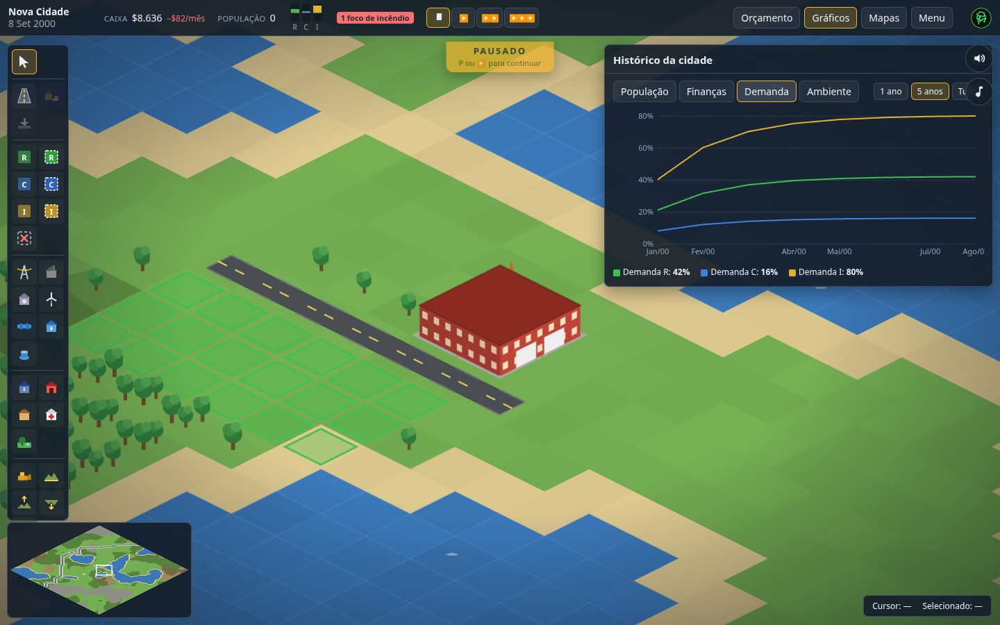
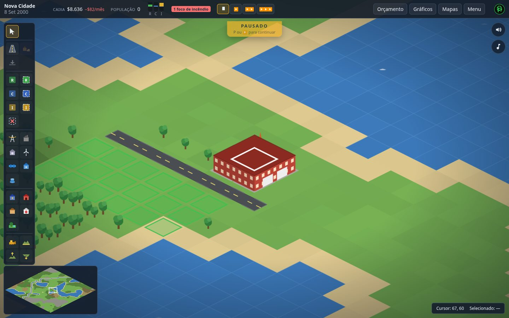

<p align="center">
  
</p>

<h1 align="center">Urbe</h1>

<p align="center"><strong>You set the conditions. The city decides the rest.</strong></p>

<p align="center">
  <a href="https://gamestudio42.github.io/urbe/"></a>
  <a href="https://github.com/gamestudio42/urbe/stargazers"></a>
  <a href="https://github.com/gamestudio42/urbe/fork"></a>
  <a href="https://github.com/gamestudio42"></a>
</p>

<p align="center">
  An isometric city builder that runs in the browser.
  Zone the land, connect power and water, keep the budget alive —
  then watch demand, traffic and disasters do the rest.
  Urbe is the civic city: growth comes from roads, zones, power, water and the budget,
  and the pressure is traffic, fire and flood.
  No install. Interface in English, Portuguese, Spanish, French and German.
</p>

<p align="center">
  <a href="https://gamestudio42.github.io/urbe/">
    
  </a>
</p>

<p align="center">
  <a href="https://gamestudio42.github.io/urbe/">
    
  </a>
</p>

## Screenshots

<p align="center">
  
</p>

<p align="center">
  
</p>

<p align="center">
  
</p>

<p align="center">
  
</p>

<p align="center">
  <a href="https://gamestudio42.github.io/urbe/">
    
  </a>
</p>

## Why Urbe

- **Play in the browser.** Open the link and found a city. Nothing to download.
- **You create the conditions.** Roads, zones, plants and pumps. The simulator grows — or abandons — the lots.
- **A civic city.** Traffic, fire and flood are the pressure on roads, zones, power, water and the budget.
- **A living city.** Cars follow traffic, chimneys smoke, water shimmers, fire engines roll out.
- **A mayor's desk.** Taxes, department funding, charts, thematic maps and a tile inspector that tells you *why* a lot is not growing.
- **Original soundtrack.** Calm lo-fi, synthesized on the fly — a slower piece in the menu, another in the city.
- **Your city stays with you.** Autosave in the browser, plus export and import of `.city.json` files.

## Play

Open **[gamestudio42.github.io/urbe](https://gamestudio42.github.io/urbe/)**.
Choose a seed, map size and difficulty, then found the city. The first visit follows your
browser language; the interface supports English, Portuguese, Spanish, French and German.
Code and docs stay in English.

| Action                                   | Shortcut    |
| ---------------------------------------- | ----------- |
| Inspect / road                           | `Q` / `R`   |
| Zones / remove zone                      | `1–6` / `0` |
| Power / water                            | `E` / `T`   |
| Pause / sound                            | `P` / `M`   |
| Underground / grid                       | `U` / `G`   |
| Cancel the current tool or close a panel | `Esc`       |

The Menu lists every shortcut. Cities autosave in the browser; export and import
`.city.json` to keep a portable copy.

## Develop

```sh
pnpm install
pnpm dev        # http://localhost:5173
```

Or with Docker: `docker compose up`.

| Command         | Description                                                 |
| --------------- | ----------------------------------------------------------- |
| `pnpm check`    | Lint, type check, unit/integration/scenario tests and build |
| `pnpm test:e2e` | Playwright end-to-end tests                                 |
| `pnpm sim`      | Headless simulation over presets and seeds                  |
| `pnpm bench`    | Tick timing benchmark (`--strict` for CI)                   |

Every push to `main` publishes `apps/web/dist` to GitHub Pages. To host it elsewhere:

```sh
BASE_PATH=/path/ pnpm build
```

Docs: [architecture](docs/architecture.md) · [simulation spec](docs/simulation-spec.md) · [balancing](docs/balancing.md) · [mechanics](docs/mechanics-matrix.md) · [roadmap](docs/roadmap.md) · [testing](docs/testing-strategy.md) · [agents](AGENTS.md) · [contributing](CONTRIBUTING.md)

## Fork & remix

Urbe is MIT-licensed. Fork it, change the rules, ship your own city on GitHub Pages.

```sh
git clone https://github.com/gamestudio42/urbe.git
cd urbe
pnpm install
pnpm dev
```

Enable Pages on your fork (the workflow in `.github/workflows/deploy.yml` already
publishes `apps/web/dist`). Or host the build anywhere:

```sh
BASE_PATH=/your-path/ pnpm build
```

Ideas and patches: [good first issues](https://github.com/gamestudio42/urbe/labels/good%20first%20issue)
and [discussions](https://github.com/gamestudio42/urbe/discussions).

## Licence

Original code, procedural sprites and synthesized sound and music, MIT licence.
Micropolis (GPLv3) and OpenSC2K were studied as references for behaviour only;
no code or assets were copied.
